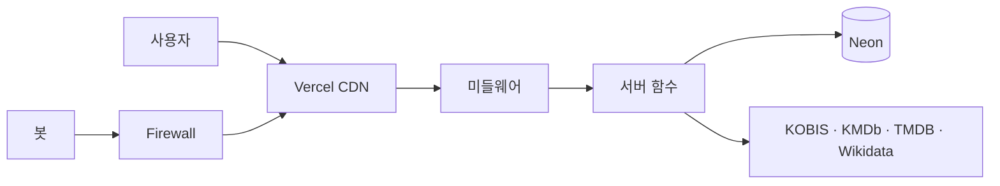

# STILL THEATER

영화를 본 뒤 별점, 한줄평, 항목별 평점(연출·연기·각본·음악·편집)을 남기는 영화 리뷰 서비스입니다.
혼자 만들고 운영하면서, 문제가 생기면 숫자로 원인을 좁히고 고친 기록을 이 README에 함께 남깁니다.

- 서비스: https://stilltheater.com
- 기간: 2026년 8월 ~ (개발 8월 ~ 10월 초, 이후 운영 중)
- 스택: Next.js (App Router), TypeScript, Prisma, PostgreSQL (Neon), NextAuth, Vercel

---

## 시작하기

<!-- ✏️ package.json의 실제 스크립트와 맞는지 확인 -->

```bash
npm install
cp .env.example .env.local   # 값 채우기 (운영 DB 주소 넣지 않기)
npx prisma migrate dev       # 로컬 DB에만
npm run dev
```

| 환경 변수 | 용도 |
|---|---|
| `DATABASE_URL` | 로컬 또는 개발용 DB |
| `NEXTAUTH_SECRET`, `NEXTAUTH_URL` | 로그인 |
| ✏️ OAuth 키 (Google, 카카오, 네이버) | 소셜 로그인 |
| ✏️ API 키 (KOBIS, KMDb, TMDB) | 영화 데이터 |

> ⚠️ `npx prisma migrate`, `db push`, `studio`는 `.env.local`이 아니라 `.env`를 읽습니다. `.env`에 운영 DB 주소가 있으면 운영 DB에 바로 붙습니다.

## 폴더 구조

<!-- ✏️ 실제 구조로 바꾸기: tree -L 2 -I node_modules -->

```
app/          페이지, API
components/   화면 부품 (영화·시리즈 공통 부품 포함)
lib/          외부 API, 영화 ID 규칙, 데이터 합치기
prisma/       DB 스키마
middleware.ts 로그인 쿠키 확인 → 비로그인은 공용 페이지로
```

---

## 어떻게 동작하나



1. 방화벽이 AI 봇과 수집 봇을 먼저 막습니다.
2. 캐시된 페이지가 있으면 CDN이 바로 돌려줍니다.
3. 없을 때만 서버 함수가 DB와 외부 API를 불러 페이지를 만듭니다.
4. 비로그인 방문자는 로그인 정보를 읽지 않는 공용 페이지(캐시됨), 로그인 사용자는 개인 페이지(캐시 안 함)를 봅니다.

## 영화 데이터는 어디서 오나

| 출처 | 쓰는 이유 |
|---|---|
| KOBIS | 박스오피스 순위, 관객 수, 누적 매출. 영화 ID의 기본 |
| KMDb | TMDB에 없는 오래된 한국 영화 |
| TMDB | 해외 드라마·시리즈, KMDb에 없는 영화 |
| Wikidata | 영화제 수상 목록 |

**같은 영화 알아보기** (한 영화의 리뷰가 둘로 나뉘지 않게)

1. TMDB 번호가 같으면 같은 영화 → 기존 ID(KOBIS 우선)에 연결
2. 번호가 없으면 제목 + 연도 (띄어쓰기·문장부호 무시, 연도 1~2년 차이 허용)
3. 포스터·줄거리를 붙일 때는 제목이 정확히 같을 때만. 애매하면 비워 둠
4. 수상작은 TMDB 제목까지 맞는지 확인한 뒤에만 연결

**영화 ID 규칙**: 형식이 다섯 가지(`kobis-`, `tmdb-`, `tmdb-tv-`, `wikidata-Q`, `kmdb-`)라서, 변환은 `movieIdToCd`, `cdToMovieId`, `isRatableMovieId`, `movieDetailPath`에서만 합니다. 화면에서 ID를 직접 자르거나 붙이지 않습니다.

---

## 문제 기록

### 문제를 좁히는 순서

1. **증상을 숫자로** — 어느 항목이 몇 %인지부터 본다
2. **숫자를 나란히** — 관련 숫자를 같이 놓고 어디서 새는지 본다
3. **가설을 측정으로** — 의심 가는 곳을 바로 고치지 않고 먼저 잰다
4. **코드에 없으면 요청을** — 코드를 고쳐도 안 줄면 누가 부르는지 본다
5. **고치고 다시 측정** — 다음 날 다시 보고, 테스트나 기준으로 다시 못 생기게 막는다

### 개발 중 (8월 ~ 10월 초)

| 문제 | 결과 |
|---|---|
| 같은 종류의 버그가 4번 반복 | ID 변환 규칙을 한 곳으로 모아 해결 |
| 시리즈 페이지만 기능이 뒤처짐 | 영화·시리즈 공통 부품으로 합쳐 해결 |
| 이메일 없는 회원이 비밀번호를 못 찾음 | 비밀번호 찾기용 이메일을 따로 저장해 해결 |

### 배포 후 (10월 14일 ~)

| 날짜 | 문제 | 상태 |
|---|---|---|
| 10/14~15 | 이미지 변환 한도 초과로 사이트 일시 정지 | ✅ 해결 |
| 10/17~19 | DB 전송량 급증 (원인: AI 봇) | ✅ 하루 260MB → 30MB |
| 10/19 | 캐시 적용 후 500 오류 343건 | ✅ 0건 |
| 10/25~31 | DB 한도 초과로 정지 | ✅ 복구 |
| 11/4~ | 외부 API(KOBIS) 한도 초과 시 오류 | 🔧 진행 중 |
| 11/5~ | 페이지 캐시 쓰기(ISR Writes) 과다 | 🔧 진행 중 |
| 11/12~ | 새 수집 봇 유입으로 사용량 증가 | 👀 방화벽 적용 후 지켜보는 중 |

| 화면 | DB 전송량 전 | 후 |
|---|---|---|
| 로그인 홈 1회 | 20.9MB | 0.25MB |
| 프로필 1회 | 1.15MB | 37KB |
| 추천 API 1회 | 908KB | 157KB |

---

## 알려진 한계

- 같은 해에 나온 같은 제목의 영화는 구분하지 못할 수 있습니다.
- 처음 보는 페이지에는 캐시가 효과가 없습니다. 봇이 새 페이지를 차례로 열면 사용량이 늘어납니다.
- AI 봇을 막아서 ChatGPT·Perplexity 같은 AI 검색에는 잘 나오지 않습니다.
- 화면 테스트(E2E)가 없습니다. 단위 테스트는 ID 규칙과 공용 페이지 설정 위주입니다.

## 관련 문서

<!-- ✏️ 노션 웹 게시 링크로 바꾸기 -->

- 개발 회고
- 서버 최적화 학습노트
- site-kit: 이 프로젝트의 구조를 다음 서비스에서 다시 쓸 수 있게 정리한 키트
