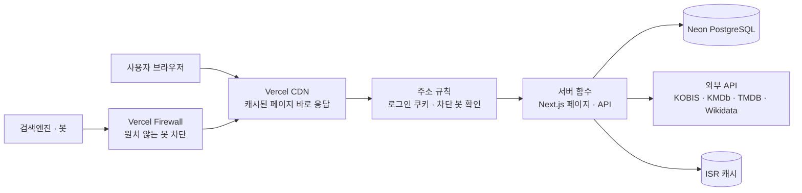

# STILL THEATER

> 영화를 본 뒤의 여운을 별점, 한줄평, 항목별 평점으로 남기는 영화 리뷰 서비스

**서비스**: [stilltheater.com](https://stilltheater.com) · **포트폴리오**: <!-- ✏️ 노션 웹 게시 링크 --> · **문의**: peterkang123@naver.com

| 항목 | 내용 |
|---|---|
| 기간 | 2026년 8월 ~ 현재 (개발 8월 첫째 주 ~ 10월 초, 이후 운영 중) |
| 인원 | 1인 (기획, 디자인, 개발, 배포, 운영) |
| 기술 | Next.js (App Router), TypeScript, Prisma, PostgreSQL (Neon), NextAuth, Vercel |

<!-- ✏️ 메인 화면 사진: docs/images/main.png 등으로 넣고 아래 줄의 주석을 푸세요 -->
<!--  -->

---

## 목차

1. [기획 배경](#1-기획-배경)
2. [주요 기능](#2-주요-기능)
3. [시스템 구조](#3-시스템-구조)
4. [기술 선택과 트레이드오프](#4-기술-선택과-트레이드오프)
5. [핵심 구현](#5-핵심-구현)
6. [트러블슈팅](#6-트러블슈팅)
7. [운영 결과](#7-운영-결과)
8. [실행 방법](#8-실행-방법)
9. [개발 원칙](#9-개발-원칙)
10. [회고와 다음 계획](#10-회고와-다음-계획)

---

## 1. 기획 배경

별점 하나로는 "연기는 좋았는데 각본이 아쉬웠다" 같은 마음을 담기 어렵고, 영화가 끝난 뒤의 여운을 남길 곳도 마땅치 않았습니다. 그래서 **연출·연기·각본·음악·편집을 나눠 평가하고, 한줄평으로 여운을 남기는 서비스**를 만들었습니다.

한국에서 만든 서비스인 만큼 최신 박스오피스뿐 아니라 오래된 한국 영화와 해외 시리즈까지 검색해서 리뷰를 남길 수 있게 하는 것을 목표로 했습니다.

## 2. 주요 기능

| 기능 | 설명 |
|---|---|
| 박스오피스 | KOBIS 일별 박스오피스 순위, 관객 수, 누적 매출 |
| 영화·시리즈·인물 정보 | KOBIS, KMDb, TMDB, Wikidata 네 곳의 데이터를 하나로 합쳐 제공 |
| 리뷰 | 별점, 한줄평, 장문평, 스포일러 가리기 |
| 항목별 평점 | 연출·연기·각본·음악·편집을 따로 평가 |
| 등급 | 리뷰가 공감을 받을수록 관객 → 씨네필 → 평론가 → 거장으로 상승 |
| 추천 | 내 평점을 바탕으로 한 영화 추천 |
| 소셜 | 나만의 영화 리스트, 팔로우, 알림 |
| 영화제 | 수상작 정보와 수상작 투표 |
| 로그인 | 아이디 가입, 소셜 로그인 (Google, 카카오, 네이버) |

## 3. 시스템 구조



1. 방화벽이 원치 않는 AI 수집 봇을 먼저 막습니다. 방화벽 규칙 수가 모자랄 때를 대비해, 같은 봇 목록(`app/_lib/bots.ts`)을 주소 규칙에서도 페이지를 만들기 전에 403으로 돌려보냅니다.
2. CDN에 캐시된 페이지가 있으면 바로 돌려줍니다.
3. 캐시에 없을 때만 서버 함수가 DB와 외부 API를 불러 페이지를 만듭니다.
4. 비로그인 방문자에게는 로그인 정보를 읽지 않는 **공용 페이지**를 캐시해서 주고, 로그인한 사용자에게는 캐시하지 않는 **개인 페이지**를 줍니다.

## 4. 기술 선택과 트레이드오프

처음에는 "빨리 만들고 무료로 운영할 수 있는가"가 가장 큰 기준이었습니다. 운영하며 그 선택의 대가를 직접 겪은 뒤, 다시 고른다면 비교할 대안을 함께 적었습니다.

| 선택 | 고른 이유 | 감수한 것 | 다시 고른다면 비교할 대안 |
|---|---|---|---|
| Next.js App Router | 화면과 API를 한 프로젝트에서 만들고 페이지 캐시(ISR)를 쓸 수 있음 | 페이지가 정적인지 동적인지가 코드 한 줄로 바뀜 (실제로 500 오류의 원인) | React + 별도 백엔드 (Spring, Express) |
| Prisma | 스키마 하나로 DB 구조와 TypeScript 타입을 함께 관리 | 기본 조회가 행 전체를 읽어, 필요한 칸만 고르지 않으면 전송량이 커짐 | SQL을 직접 쓰는 가벼운 쿼리 빌더 |
| NextAuth | 소셜 로그인 세 곳을 같은 방식으로 붙일 수 있음 | 서버에서 로그인 정보를 읽으면 그 페이지는 캐시되지 않음 | 로그인 정보만 브라우저에서 따로 불러오는 구조 |
| Vercel 무료 플랜 | 배포가 쉽고 CDN이 기본 제공 | 한도를 넘으면 사이트가 멈춤 (최근 30일 누적 집계) | 유료 플랜 + 비용 상한 |
| Neon 서버리스 DB | 무료이고 요청이 없으면 DB가 잠듦 | 5분 동안 요청이 없어야 잠듦 | 항상 켜져 있는 관리형 DB (Supabase, RDS) |
| 외부 API 결과를 DB에 저장 | 같은 데이터를 반복해서 부르지 않음 | 저장 공간과 전송량이 늘어남 | 매번 호출하고 짧게 캐시만 하기 |

**지금 다시 만든다면** 외부 API를 부르는 시점을 나누겠습니다. 아무 영화나 검색할 수 있어야 하므로 처음 찾는 영화는 요청할 때 불러와야 하지만, 박스오피스처럼 하루 단위로 바뀌는 데이터는 미리 수집해 두고, 검색봇의 요청에는 DB에 이미 있는 영화만 보여 주는 편이 나았습니다. 방문자 수와 외부 API 사용량이 서로 묶이지 않게 하는 것이 핵심입니다.

## 5. 핵심 구현

### 5-1. 네 곳의 영화 데이터를 하나로 합치기

| 출처 | 맡은 역할 |
|---|---|
| KOBIS (영화진흥위원회) | 박스오피스 순위, 관객 수, 누적 매출. 영화 ID의 기본 |
| KMDb (한국영화데이터베이스) | TMDB에 없는 오래된 한국 영화 정보 |
| TMDB | 해외 드라마·시리즈, KMDb에 없는 영화 정보 |
| Wikidata | 영화제 수상 목록 |

네 곳이 같은 영화를 서로 다른 번호로 부르기 때문에, **한 영화의 평점과 리뷰가 두 곳으로 나뉘지 않게** 같은 영화를 알아보는 규칙을 만들었습니다.

1. **TMDB 번호가 같으면 같은 영화**: 저장된 영화(`CachedMovie`)에 TMDB 번호를 함께 적어 두고, 검색 결과의 TMDB 번호로 기존 영화를 찾아 기존 ID(KOBIS 코드 우선)에 연결합니다.
2. **번호가 없으면 제목과 연도**: 띄어쓰기와 문장부호를 뺀 제목으로 비교하고("존 윅 3" = "존윅 3"), 국내·해외 개봉 연도 차이를 고려해 1~2년 차이까지 허용합니다.
3. **포스터·줄거리를 다른 출처에서 붙일 때는 더 엄격하게**: 제목이 정확히 같아야 하고, 맞는 것이 없으면 붙이지 않습니다. 흔한 제목에 엉뚱한 포스터가 붙는 것보다 비워 두는 편이 낫다고 판단했습니다.
4. **수상작은 검증을 통과해야 연결**: Wikidata가 준 TMDB 번호를 바로 믿지 않고, TMDB의 한글·영문·원제 제목이 맞는지 확인한 뒤에만 연결합니다. 검증 전 항목은 사이트맵에도 넣지 않습니다.

> KOBIS가 기본, TMDB 번호가 연결 고리. 번호가 없으면 제목과 연도로 맞추고, 확실하지 않으면 붙이지 않는다.

### 5-2. 영화 ID 규칙을 한 곳에 모으기

출처가 네 곳이다 보니 영화 ID 형식이 다섯 가지(`kobis-…`, `tmdb-…`, `tmdb-tv-…`, `wikidata-Q…`, `kmdb-…`)가 됐습니다. ID 변환 규칙을 아래 함수에만 두고 모든 화면이 이 함수를 쓰게 했습니다. 다섯 형식을 모두 확인하는 단위 테스트가 있습니다.

| 함수 | 하는 일 |
|---|---|
| `movieIdToCd` / `cdToMovieId` | 주소의 영화 ID ↔ 저장용 코드 변환 |
| `isRatableMovieId` | 평점을 남길 수 있는 영화인지 확인 |
| `movieDetailPath` | 영화·시리즈에 맞는 상세 페이지 주소 생성 |

### 5-3. 비로그인 공용 페이지 캐시

모든 페이지 위의 헤더가 로그인 정보를 읽어서, 요청의 약 93%가 매번 서버 함수를 실행하고 있었습니다. 주소 규칙(`next.config.ts`)이 로그인 쿠키를 확인해 비로그인 방문자는 로그인 정보를 읽지 않는 공용 페이지로 보내고, 공용 페이지는 정적으로 고정해 CDN에서 응답하게 했습니다. 공용 페이지가 로그인 정보를 읽거나 정적 설정이 빠지면 실패하는 테스트를 두어 같은 실수가 다시 배포되지 않게 했습니다.

### 5-4. 비밀번호 찾기용 이메일 분리

계정 이메일 칸은 소셜 로그인 계정 연결에도 쓰이기 때문에, 확인되지 않은 이메일을 넣으면 남의 소셜 로그인을 막거나 가로챌 위험이 있었습니다. 비밀번호 찾기용 이메일을 별도 테이블로 분리했고, 기존 테이블은 건드리지 않아 배포와 DB 변경 중 어느 쪽이 먼저 일어나도 안전하게 했습니다.

## 6. 트러블슈팅

### 개발 중: 구조에서 찾은 원인

| 문제 | 원인 | 해결 |
|---|---|---|
| 같은 종류의 버그가 4번 반복 (평점 버튼 막힘, 링크 깨짐 등) | ID 변환 코드가 화면마다 복사돼 있었음 | 변환 함수 4개로 모으고 단위 테스트 추가 (5-2) |
| 시리즈 페이지만 기능이 뒤처짐 | 영화 코드를 복사해 두 벌로 관리 | 공통 컴포넌트(`MovieHero`, `DetailReviews` 등)로 합침 |
| 이메일 없는 회원의 비밀번호 분실 | 계정 이메일 칸이 소셜 로그인 연결과 얽혀 있음 | 비밀번호 찾기용 이메일 테이블 분리 (5-4) |

### 배포 후: 숫자로 좁혀 간 원인

<details>
<summary><b>이미지 변환 한도 초과로 사이트 전체가 멈춤 (10월 14일 ~ 15일)</b></summary>

- **증상**: 방문자가 늘자 "This deployment is temporarily paused"
- **찾은 방법**: Vercel 사용량 항목 중 이미지 변환만 17,000회 / 한도 5,000회
- **원인**: Next.js 기본 이미지 컴포넌트가 포스터 수천 장을 화면 크기별로 서버에서 변환
- **해결**: 이미지 로더를 만들어 TMDB가 미리 만들어 둔 크기의 이미지를 바로 사용
- **결과**: 이미지 변환 새로 0회
</details>

<details>
<summary><b>캐시 적용 후 30분 만에 500 오류 343건 (10월 19일)</b></summary>

- **증상**: 공용 페이지 캐시를 적용한 직후 비로그인 페이지에서 500 오류
- **찾은 방법**: 로그의 "Page changed from static to dynamic at runtime"을 로컬에서 재현
- **원인**: 캐시용 페이지 안에서 예고편·수상 기록·시리즈 정보를 요청마다 새로 불러오고 있었음
- **해결**: 공용 페이지 4개를 정적으로 고정하고, 설정이 빠지면 실패하는 테스트 추가
- **결과**: 500 오류 0건, 두 번째 요청부터 캐시에서 응답
</details>

<details>
<summary><b>추측이 틀렸던 DB 전송량, 원인은 AI 봇 (10월 17일 ~ 19일)</b></summary>

- **증상**: Neon 월 전송량 5GB 중 80% 사용 경고
- **첫 추측**: 예고편 테이블 → SQL로 재 보니 한 행 119바이트, 원인 아님
- **측정 후 수정**: 목록 화면이 쓰지 않는 칸까지 읽고 있어 필요한 칸만 읽게 변경, 개발 DB 분리 → 로그인 홈 1회 20.9MB → 0.25MB
- **그래도 줄지 않음**: 요청 로그에서 5초 간격으로 매번 다른 페이지를 여는 패턴 → AI 검색 봇
- **해결**: Vercel Firewall 규칙으로 차단 (robots.txt는 허용)
- **결과**: 하루 DB 전송량 약 260MB → 약 30MB
</details>

### 지금 해결 중

- **ISR Writes**: 봇 차단 뒤 하루 증가량은 2.3만 → 1.7만으로 줄었지만 목표(하루 6,600)의 약 2.5배. 같은 페이지를 다시 만들 때마다 내용은 같아도 바이트가 달라 매번 새로 저장되던 문제를 고쳤고(5번 다시 만들면 5번 모두 달랐음 → 모두 같음), 다시 만드는 주기를 늘리고(홈 10분 → 6시간, 상세 1시간 → 하루), 외부 API 결과를 데이터 캐시에 한 번 더 쓰지 않게 했습니다. 남은 것은 구글봇이 처음 여는 페이지의 저장 비용이라, 저장된 페이지가 늘수록 줄어드는지 지켜보는 중입니다. 배포하면 저장된 페이지가 모두 비워지므로 배포 횟수도 줄이고 있습니다.

**해결됨**

- **외부 API 한도 초과 시 오류 (11월 4일)**: KOBIS 하루 한도가 끝나도 DB에 저장된 영화는 그대로 보여 주고, DB에도 없으면 오류 페이지를 캐시하지 않고 503과 다시 올 시간(Retry-After)을 줍니다. 같은 오류 로그가 요청 하나에 4~5줄 찍히던 것도 한 줄로 줄였습니다.

## 7. 운영 결과

| 무엇을 | 전 | 후 |
|---|---|---|
| 이미지 변환 | 17,000회 / 한도 5,000회 | 새로 0회 |
| 캐시 적용 후 500 오류 | 30분에 343건 | 0건 |
| 로그인 홈 1회 DB 전송량 | 20.9MB | 0.25MB |
| 프로필 페이지 1회 DB 전송량 | 1.15MB | 37KB |
| 추천 API 1회 DB 전송량 | 908KB | 157KB |
| 하루 DB 전송량 | 약 260MB | 약 30MB |

홈·프로필·추천 수치는 운영 DB에 직접 접근하지 않기 위해, 운영과 비슷한 규모(영화 8천 편, 평점 4만 8천 개)의 테스트 DB 앞에 바이트를 세는 중계기를 두고 잰 값입니다.

## 8. 실행 방법

개발은 내 컴퓨터의 로컬 DB(Docker)로 합니다. 운영 DB에 붙여 개발하면 그 조회가 모두 운영 DB의 무료 한도에 잡힙니다.

```bash
git clone https://github.com/Kang-min-jae/review-kobis.git
cd review-kobis
npm install
docker compose up -d          # 로컬 Postgres(5432) + Neon 웹소켓 중계기(5433)
cp .env.example .env.local    # 값을 채워 넣기 (DATABASE_URL은 이미 로컬 DB를 가리킴)
npm run db:local              # 로컬 DB에 테이블 만들기 (주소가 로컬일 때만 실행됨)
npm run dev
```

| 환경 변수 | 용도 |
|---|---|
| `DATABASE_URL` | PostgreSQL 연결 주소 (개발은 로컬 DB) |
| `AUTH_SECRET` | 로그인 쿠키 서명 (Auth.js) |
| `AUTH_GOOGLE_ID`·`AUTH_GOOGLE_SECRET`, `AUTH_KAKAO_ID`·`AUTH_KAKAO_SECRET`, `AUTH_NAVER_ID`·`AUTH_NAVER_SECRET` | 소셜 로그인 (선택) |
| `KOFIC_API_KEY`, `KMDB_API_KEY`, `TMDB_API_KEY` | 영화 데이터 (KOBIS · KMDb · TMDB) |
| `RESEND_API_KEY`, `EMAIL_FROM` | 비밀번호 재설정 메일 (선택) |
| `ANTHROPIC_API_KEY` | 추천 이유 문장 (선택) |
| `CRON_SECRET`, `ADMIN_SECRET` | 예약 작업·관리용 API 확인 (선택) |

- 개발 서버는 원격 DB 주소로는 시작하지 않습니다. 꼭 필요할 때만 `ALLOW_REMOTE_DB_IN_DEV=1 npm run dev`로 엽니다.
- 테스트: `npm test` · 린트: `npm run lint`

> ⚠️ Prisma CLI(`migrate`, `db push`, `studio`)는 `.env.local`이 아니라 `.env`를 읽습니다. `.env`에 운영 DB 주소를 두지 마세요. 로컬 DB에 테이블을 만들 때는 `npx prisma db push` 대신 `npm run db:local`을 씁니다.

## 9. 개발 원칙

운영하며 겪은 문제를 다시 겪지 않기 위해 지키는 규칙입니다.

- **운영 DB로 테스트하지 않는다.** 로컬 DB와 가짜 외부 API로만 테스트합니다.
- **개인 정보가 든 응답은 캐시하지 않는다.** 내 리뷰, 내 별점, 관리자 도구는 CDN·ISR에 저장되지 않아야 합니다.
- **같은 규칙은 한 곳에만 둔다.** 같은 버그가 두 번 나오면 규칙이 흩어진 곳부터 찾습니다.
- **필요한 칸만 읽는다.** 목록 화면에서 행 전체를 읽지 않습니다.
- **고친 뒤에는 다시 잰다.** 배포 다음 날 같은 시간에 사용량을 비교하고, 같은 실수를 잡는 테스트를 남깁니다.
- **검색엔진 봇은 막지 않는다.** Googlebot, 네이버 Yeti, Bingbot, 다음 봇은 허용하고, 대량 수집하는 AI 봇만 막습니다.

## 10. 회고와 다음 계획

혼자 AI 코딩 도구와 함께 만들면서, 원리를 모르고 고치면 하나를 고칠 때 다른 문제가 생긴다는 것을 배웠습니다. 지금은 문제를 숫자로 정리하고, 원인을 측정으로 확인한 뒤, 근거와 트레이드오프를 따져 고칩니다.

**관련 문서**

- 개발 회고: <!-- ✏️ 노션 웹 게시 링크 -->
- 서버 최적화 학습노트: <!-- ✏️ 링크 -->
- Full-Stack Fundamentals: <!-- ✏️ 노션 웹 게시 링크 -->
- 협업 필터링("추천 N%") 설계와 설정: [docs/collaborative-filtering.md](docs/collaborative-filtering.md)
- site-kit (이 프로젝트의 구조를 다시 쓸 수 있게 정리한 범용 키트): <!-- ✏️ GitHub 링크 -->

**다음 계획**: STILL THEATER에서 겪은 운영 사고를 재현하는 실험실을 만들고, AI 코딩 에이전트가 같은 사고를 다시 일으키는지, 사고가 난 뒤 원인을 찾아내는지 숫자로 검증하는 프로젝트를 준비하고 있습니다.

---

**만든 사람**: 강민재 · [GitHub](https://github.com/Kang-min-jae) · peterkang123@naver.com
